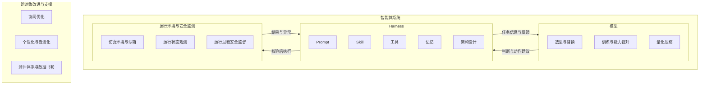

# 页面与交互设计草案

状态：首页v0.12，实际数据工作台v0.9，前言内容v0.8，其余课程延续v0.6 · 2026-11-25。首页最新内容和播放见[HOME-V12.md](HOME-V12.md)。对象地图从站点首页移至第1章，深色架构演示先于总纲。以下修订覆盖初稿对应版式，详见[VISUAL-RESET.md](VISUAL-RESET.md)。

## 本轮实际布局修订

F01/P01/P03当前共用章节页头与阅读排版：章节位置、页面标题、摘要依次展示；正文限制行宽，图表按需加宽。章节入口回到页首，子目录定位到对应标题；重复选择、刷新和返回使用一致定位。侧栏目录独立滚动，底部说明不与目录重叠。尺寸与交互规范见[DESIGN.md](../../DESIGN.md)“章节阅读排版与目录定位”。 当前进一步参考Obsidian的阅读密度：目录13px、左侧折叠箭头、纯文字编号、单行省略与完整标题提示；阅读标题26px、正文16px/1.8，弱化父级大底色和页头分隔线。

P04—P06当前以[REAL-DATA-WORKSPACE.md](REAL-DATA-WORKSPACE.md)和实际页面为准：本地实际导出、分页检索、当前阶段切换、扁平时间线、证据/任务两栏、真实原文引用与人工映射；旧文案中的模拟案例、编号阶段条和预设辅助结果不再适用。

- H01/F01：增加指南首页与前言，采用同一全书左目录；深色架构科普只在前言。
- P01/P02：位于第1章的 `/guide`；顶部只有短导入，彩色关系图承担主要篇幅，三条经验在右。对象定义/作用改为浮窗，仅模型入口可用；协作动画默认连续播放。阅读/实操按钮统一在地图下方。
- P03：沿用同一全书目录，仅更新当前章节/子目录。总纲正文中的四环节保留浅色2×2回路，重点解释六环节与Trace/Observation映射；不再占用深色架构科普的角色。
- P04：顶部查询工具栏约98px，查询/筛选/开始入口同区；结果与详情并排。高级条件及问题/预期补充按需展开。原下文示意中的大表单和底部开始按钮被此方案替代。
- 配色、字级和主要图形以当前原型为准，原稿中的组件尺寸不是僵硬的实现模板。

## 1. 页面组织与文案边界

### 七类主页面，八个设计单元

站点首页为整本指南导览，前言单独成章。P01导览与P02对象地图位于同一个“第1章·总纲导览”页面，依次阅读；不要求先跳一页才能看到地图。保留P01/P02编号，方便设计稿对照。

| 单元 | 所在页面 | 读者的主要任务 | 主要呈现 |
| --- | --- | --- | --- |
| H01 | 首页1 / 首页2 | 理解医疗设备智能体的完整调优SOP，开始阅读或实操 | 书册视觉 / 常驻SOP时间线与分阶段情境阅读页；两个真实入口、四目标说明、章节目录 |
| F01 | 前言 `/preface` | 明确背景、目标、范围、路径与协作 | 连贯正文、四项目标、范围与路径；原理演示作为补充 |
| P01 | 总纲导览·开篇 | 知道为什么学、能解决什么问题 | 短文、三条原则 |
| P02 | 总纲导览·对象地图 | 看懂关系、查看对象、选择学习或实操 | React Flow分组关系图＋定义/作用浮窗＋下方分流 |
| P03 | 课程阅读 | 连贯理解方法，必要时试一试 | 正文、随文图表、局部练习 |
| P04 | 真实排查 | 找到案例或恢复调查 | 查询表单、结果表、详情预览 |
| P05 | SOP工作台 | 拆解、定位、核对和判断 | 拆解为结构/原文；后续为证据/任务，循环树按需展开 |
| P06 | 排查记录 | 看清候选与下一步 | 结论摘要、简洁比较表、验证清单 |

全站使用同一固定左目录：首页1、首页2、第0—6章、真实排查与我的排查记录。前言在调优总纲之前，总纲内部再展开对象地图和方法子目录；模型是第3章。目录内容不随页面替换，只更新当前项和展开层级。顶部保留品牌、章节查找、打印与原型状态；工作台使用当前阶段切换，不再使用顶部编号阶段条。窄屏将同一目录收为抽屉。

### 屏幕文案与设计记录分开

- 本文的屏幕文案框只写读者实际会看到的文字；方括号表示控件或输入区域，不代表把组件名称展示给读者。
- 受众、设计目的、尺寸、组件名、来源文件页码、开发说明、数据字段契约放在文案框之外。
- “面向研发和产品同事”“正文34–42字/行”“本节问题与简短导入”等是设计记录，不进入产品文案。
- 实际影响任务的信息保留：搜索范围、时区、原文来源、截断、未保存、权限和错误。SOP版本、映射版本等集中在“来源与记录”详情，不抢占主标题。
- “已保存”等状态文案只在对应操作成功后出现，不能因文案框列出就固定渲染。正式查询与案例来自实际数据；当前用户已授权前端原型使用明确标识的模拟记录和辅助结果，先验证布局交互。
- 首次解释会话、Trace、循环、Observation，后续使用一致名称；按钮写出当前操作结果。

## H01 首页1与首页2

当前以[HOME-V12.md](HOME-V12.md)为准。主标题为“医疗设备智能体的调优方法与实践”，摘要明确发现问题、对象定位、专项方法与案例、验证和持续更新的完整路径。书名由全局品牌承担；首页不能泛化为整个医疗行业，也不能用三层交付图代替指南定位。

首页1保留书册与章节卡片；首页2保留左右阅读页，左侧常驻五阶段有序时间线，右侧按阶段展示设备号重复追问的情境、归因核对、对象专项方法与实践案例、对照验证和沉淀更新。默认按顺序播放，阶段内部依次强调；手动查看即暂停，支持下一阶段、重播和减少动态效果。情境不挂假的Trace，条件归因不自动宣布根因，未完成章节明确待补充。场景共享自然高度，播放不推动下方布局跳动。

四目标带简释，明确有章可循、有人负责、有案例可查、有资产可沉淀。“有人负责”指责任团队和流转路径。阅读、实际排查、目录三个入口保持简单，待补充章节无空链接。

## F01 前言

阅读顺序按用户原图重构：1.编写背景（1.1行业背景、1.2医疗特殊性、1.3内部现状、1.4四个不统一）→ 2.编写目标与核心章节 → 3.适用范围与使用方式（范围、角色表、三路径、协作SOP）→ 4.编写、评审与维护机制 → 引用 → 补充：Agent怎样运行。完整层级、来源缺口与实现规则见[PREFACE-REBUILD.md](PREFACE-REBUILD.md)。

协作SOP使用React Flow还原三入口、三层分流和反馈闭环，支持选择八条责任路线、流动连线、播放/暂停/逐步与说明联动；原图保留用于对照。标题和目录当前均去掉数字编号，表头与短字段保持单行，窄屏表格内部滚动。原有三层职责、深色演示与循环说明统一归入一个补充部分；深色演示采用左侧情境和播放控制、右侧可查看的架构图、下方当前步骤/示例记录。三个情境为信息齐全、缺少上下文、工具超时；展示输入护栏、上下文、模型、路由、工具、观察、输出护栏、最终交付，以及记忆/Skills的输入关系。反馈回路避开节点，结束分支走上方，保持文字可读。

- 播放/暂停、下一步、重置均可用；结束不越界，切换情境从头开始。
- 点击或键盘选择组件可查看作用并暂停演示；可返回当前步骤。
- 示例记录只解释当前教学状态，不写入真实排查，不调用LLM或Langfuse。
- 窄屏情境与控制移到上方，画布局部横向滚动；原文解释仍自然换行。
- 页尾“进入第1章：调优总纲”到 `/guide`；子目录可通过 `?section=` 直达并在刷新时恢复。

## 2. P01 总纲导览·开篇

### 屏幕文案与阅读顺序

```text
从问题现象，找到优化对象。
先看清系统如何配合，再用一次运行逐步定位问题。

优化对象与关系
[主要区域：对象关系地图]           三条调优经验
                                 先检查输入和执行机制
                                 一次尽量只改一个对象
                                 先查清现有机制

看懂系统，然后动手。
从总纲建立方法，或带着一个案例开始。
[开始阅读总纲 →]  [直接开始实操 →]
```

- 地图是主要篇幅；经验是右侧紧凑说明，不放在地图前占大块区域。
- 两个分流入口统一放在图下，阅读按钮可有轻微箭头动效；不在标题旁重复放实操按钮。
- 对象说明不常驻右侧。所有对象可查看，只有模型浮窗按钮可跳转。
- 主目录与课程页保持同一份内容，当前项高亮及子目录展开随位置更新。

## 3. P02 待优化对象地图：使用图组件

### 图的结构与组件要求

默认使用 **React Flow（`@xyflow/react`）分组节点和关系边**。下面的Mermaid只是文档中的结构示意，不是把图组件替换成文本树或将其静态截图铺到网页。



- 分组容器表达从属层级；带箭头和标签的边表达信息/控制关系，二者使用不同视觉语法。不把所有对象串成先后流程。
- 组标题本身可选，不在组内再重复一个同名父节点。组内直接排具体对象，避免名称重复和从属线拥挤。
- 模型与Harness并列，环境位于下方，跨对象支撑单列成带；采用稳定布局。Harness五个子对象首屏可选，不需要先展开父节点。
- 地图下的全局按钮分别进入运行章节和案例查询；节点浮窗的按钮与全局分流分开，目前仅模型可进入已写好的模型课程。
- 地图只承担理解关系和导航。节点只放名称；定义与作用放悬浮/点击浮窗，右侧为经验，避免节点塞文章或详情永久占栏。

### 悬浮或点击“记忆”时的浮窗文案

```text
记忆

定义
管理可在后续交互中使用的信息的机制。

作用
保存和取回任务历史、关键信息或偏好，为后续任务提供所需信息。

[对应内容待开放 · 禁用]
```

### 交互与布局约束

- 悬浮查看定义/作用，点击或键盘Enter/Space固定浮窗；进入浮窗可操作，移开未固定浮窗稍后收起。Escape、关闭按钮和点击外部可关闭。动画不改变用户选择，不自动跳页或调用LLM。
- 所有对象均可悬浮或点击查看定义与作用；说明采用浮窗，不占永久右栏。浮窗只保留一个小入口，目前仅“模型”的“进入模型优化”可用，跳至已有模型课程；其余对象显示禁用的“对应内容待开放”。不在导览浮窗加入证据、检查项或诊断建议。
- 具体对象正文需要前置概念时给出简短说明和返回主线的链接，不直接把初学者扔进密集决策全图。
- 图下“开始阅读总纲”到运行章节，“直接开始实操”到P04；地图所选对象不当作已确认归因。
- 默认不可拖动节点、连新线或改拓扑；可平移、缩放、恢复全图。缩放不能把正文挤成不可读小字。
- 地图区域内普通滚轮继续滚动页面；缩放用显式按钮或组合键/手势，避免阅读滚到图上就被困住。
- 宽屏地图与三条经验相邻；窄屏经验移至图下。定义/作用浮窗限制在视口内。保留展开图和等价列表，列表是辅助。
- 图像关系说明、键盘顺序和文字等价视图一并设计。选中节点后保持合理视口，不每次重置全图。
- 实现依据：[React Flow分组](https://reactflow.dev/learn/layouting/sub-flows)、[视口交互](https://reactflow.dev/learn/concepts/the-viewport)。

## 4. P03 课程阅读页

### 屏幕文案

```text
总纲
  优化对象
  看懂一次运行
  定位异常位置
  核对模型输入
  判断优化方向
  验证与建设性需求
  完整案例

看懂一次运行
一次交互中，智能体可能多次准备上下文、调用模型、执行动作和处理结果。
先看清这些循环，再检查问题出现在哪个环节。

一次运行是怎样展开的
请求接收 → Agent Loop（内部循环）→ 输出交付

循环中的四个环节
② 上下文准备与组装
③ 模型调用与返回
④ 动作校验、调度与执行
⑤ 结果处理、校验与状态更新

[查看原始记录的对应位置]

试着判断
没有调用工具，能说明这次循环出错了吗？
[选择答案]  [查看解释]

[下一节：定位异常位置]  [用真实案例练习]
```

### 不同内容采用不同组件

| 内容 | 呈现与交互 | 阅读约束 |
| --- | --- | --- |
| 为什么与概念 | 正文、短小标题、必要术语解释 | 主线默认展开，不把段落装进卡片或Tabs |
| 对象关系 | 复用P02图组件 | 定义/作用仍是简洁详情，不混入检查清单 |
| ①/⑥与循环②–⑤ | 有边界和回边的只读流程图 | 点环节联动说明；重复循环显示为循环序列，不铺满全部原始节点 |
| 材料来源与对象对照 | 语义表格 | 少量静态行默认完整可读，不加搜索/分页 |
| 三种定位方法 | 三个清晰标签切换入口说明，共用核对图 | 切换只改变对应方法，不清空学习进度或重置页面 |
| 模型上下文 | 角色消息、来源标签、原文引用 | 保留消息顺序，JSON为补充入口 |
| 核心判断路线 | 当前问题＋已走路径，全图按需展开 | 避免一开始就让读者在密集全图中找入口 |
| 候选比较与验证 | 简表＋清单 | 对照信息用表，具体动作按顺序列出 |
| 完整案例 | 阶段导航＋证据联动 | 教学参考路径在尝试后展示，不自动替读者作答 |

### 排版与练习

- 正文约17px、1.8–1.9行高，每行约34–42个全角汉字；这是设计参数，不进入页面文案。标题、正文和图注采用稳定层级。
- 每次只引入一个主要问题，解释后紧接图表，再接短结论；避免先连续大段文字、最后才堆所有图。
- 课程目录在左，本节目录在右按篇幅出现；正文短时不增加空的右栏。学习提示不占永久第三栏。
- 必要解释默认可见；实现细节、长JSON、补充例子用Collapsible/Accordion，不用折叠隐藏结论。
- 练习答案用Radio Group，提交后在原处展示依据和可修改入口；不弹出打断阅读的结果对话框，不强制全部练习通过才能继续。
- 进入实操前保留章节和滚动位置。章节学习结果与真实案例判断分开，不给真实案例套固定答案判分。
- 从某次调查进入课程时显示“返回当前排查”，复用既有调查；从纯阅读进入练习时到P04带入学习主题，不跳过Trace选择和必要证据准备。

## 5. P04 真实排查：检索与恢复

### 屏幕文案

```text
真实排查
[查找案例]  [我的排查]

项目 [选择项目]    时间范围 [选择范围]
[会话 ID]  [关键词]
会话 ID [                         ]  [查询]

查询结果
主要 Trace | 时间 | 用户请求 | 最终回复 | 执行状态

案例预览
用户请求
最终回复
相关轮次
[加入对照]

异常表现 [                         ]
期望表现 [                         ]

[开始拆解运行]
```

### 表单与结果行为

- Session精确查询只展示所需字段；关键词模式再显示可搜字段及范围。项目/时间有可见默认值，不要求首次使用先填完一张复杂表单。
- 有多行、排序和分页需求的结果用TanStack Table；主要Trace用单选，点击行主体预览，底部只有一次“开始拆解运行”，不再要求另点一次“设为主要Trace”。
- 对照轮次采用明确的加入/移除操作。来源、匹配片段等可展开；不要把所有input/output塞成超宽表格。
- 请求前保留参数，请求中显示结果区加载状态。无结果显示已查范围及调整入口；失败、无权限、部分覆盖分别反馈。
- 期望可稍后补；涉及业务符合性的比较前再要求明确。只查记录时不以缺预期阻塞。
- “我的排查”显示名称、阶段、待补项、更新时间；打开后回到保存位置。

## 6. P05 SOP工作台

### 共同框架与文案

全站固定左目录继续保留；工作区不再固定放三个内部栏位。

```text
案例名称                               返回学习  已保存
拆解运行 → 定位异常 → 核对输入 → 判断方向 → 排查记录

拆解阶段：
先看清这次运行                   [确认拆解，开始定位]
运行结构                         对应原始记录
① 接收                          输入 / 输出 / 状态
循环1：② → ③ → ④ → ⑤          消息 / JSON
循环2：② → ③ → ④ → ⑤
⑥ 交付

后续判断阶段：
当前循环与环节                   [选择循环与环节 ▾]
实际证据                         当前判断任务
原文 / 状态 / 引用               方法 / 标准 / 答案 / 依据
```

拆解页让读者先读完整结构，再点环节对照原文；确认操作在上方。后续证据与任务并排，循环树/原始记录树通过按钮打开浮层，不永久挤占第三栏；Escape、关闭或遮罩可收起。小屏拆解上下排列，后续用循环/证据/判断标签。尺寸与组件名不进入屏幕文案。

### W1 拆解运行

- 系统按实际埋点提供①/⑥、N次循环及②–⑤映射，用户先浏览和确认；无需逐条人工重建每条Observation。
- 拆解阶段直接浏览各次循环，每次用四个环节按钮对应右侧原文；后续阶段的循环/原始树按需打开。未映射、未记录、未发生分开显示。
- 改边界或关联时才展开编辑工具，保留映射版本、依赖和并行/重试信息。
- 主操作为“确认拆解，开始定位”。尚不能确认的部分可保留待查，不伪装已映射。

### W2 定位异常

- “关键词 / 异常状态 / 从头对比”用Tabs切换当前入口，当前循环与核对笔记不随之清空。
- 各入口展示自己需要的控件：关键词搜索；异常记录列表；或预期与逐循环比较。下方共用当前循环及环节核对区。
- 先选循环，再点相关环节看原文；①/⑥可直接选。搜索命中、运行错误、用户确认异常分别标记。
- 核对结果选择“符合预期 / 不符合预期 / 证据不足”。已有证据可引用，不要求每个看过的正常循环写长说明；不符与不足记录具体偏差或缺口。
- 可主动点“LLM辅助定位”，在同一任务区确认范围后发起一次请求。建议返回后展示候选及依据，点击回原文，“加入待核对”不自动确认。
- 用户确认关键位置后，主操作为“继续分析这个位置”。有相关模型调用时打开实际输入；无相关调用时继续查看执行证据并保留适用性/缺口，不制造模型输入或强制通过三标准。

### W3 核对输入

- 默认角色消息与原文；来源标签辅助定位，不重排或改写原输入。JSON按需打开，不能成为产品同事必须先读的第一屏。
- 左右对比用于不同调用或前后版本，不为同一份输入重复摆两份窗口。
- 三标准用三个可见检查项，每项Radio Group；同一时间展开一个依据编辑区，仍能看到另外两项的已选状态。
- 当前调用引用自动带入，支持多项共用引用；“满足”的简短备注可选，“不满足 / 证据不足”需要偏差或缺口说明。无需重复抄写输入。
- LLM意见留在辅助区，可收起；采纳只填入草稿，用户用唯一的“保存判断并继续”提交。
- 内容未读全、被截断或附件不可见时提示缺口，不默认勾选满足。

### W4 判断方向

- 当前判断问题、标准、答案和原文同时可见；已走路径用紧凑路径条，完整React Flow决策图按需展开。
- 答案选择后可修改；提交才更新路径。返回上游时说明哪些下游待复核，不删除历史或重置整个调查。
- 阶段导航可返回已访问阶段；查看后续标准不等于提交有效结论。
- 当前任务最多一个主要提交按钮；“补信息 / LLM辅助”是次级操作，不与提交争抢视觉重点。

### W5 保存、辅助与错误反馈

- 草稿保存、判断提交分别反馈；保存失败时保留本地输入并提供重试，离开时说明是否未保存。
- 补材料优先在当前任务内展开；只有确实影响离开未保存内容时才用确认对话框。
- LLM请求显示用途、范围、进行中状态与取消；错误/超时在原处反馈，人工操作可继续。
- 来源或映射变更时相关建议与判断待复核；候选可保留为历史，不能沿用旧答案冒充当前结论。
- 关闭图或说明侧栏后恢复原焦点与证据位置，不层层套Sheet/Dialog。

## 7. P06 排查记录与验证

### 屏幕文案

```text
排查记录                         [导出摘要]

问题与预期
候选优化对象
候选对象 | 主要依据 | 下一步核查

待补信息
验证计划
[添加验证结果]

[返回核对]  [学习相关方法]

[查看决策路径与来源]
```

### 结果阅读顺序

- 先看到问题、候选和下一步，再展开长路径、反向证据、源ID与SOP/映射版本。
- 少量候选用三列表格和可展开行；仅当排序/筛选真有必要时启用复杂表格功能。深链点到具体循环/环节及判断。
- 记录状态区分待补充、已形成候选、待验证等；完成向导不宣称问题已修复。
- 验证计划用清单，实际结果是独立记录。没有验证结果时不显示通过徽章或成功动画。
- “学习相关方法”保留调查状态；从课程返回仍在原位置。

## 8. 组件与响应式的共同规则

- 截图用缩放容器＋编号标注和相邻说明，原图来源、裁剪/脱敏范围可查；可复制文字不得只放在图片里。
- Tabs用于同一任务的互斥视图；Accordion用于次要细节；有先后顺序的操作用阶段导航；关系用图；对照用表。不能把它们互相替代。
- 图的普通滚轮不阻塞文章滚动，表格仅局部横滚，原文只有一个主要阅读滚动区。
- 空间不足时循环栏可收起，证据与任务上下排列；窄屏以“循环 / 证据 / 判断”切换，始终显示当前目标，返回不丢输入。
- 正文缩放、长中文标签、长ID与200%缩放需验证；图内字号不靠无限缩小解决布局。
- 所有选择有文本状态和焦点，不能只凭颜色；图提供等价列表，分栏可用键盘调整。
- 动效只用于展开、选中、路径变化和反馈；不滚动自动答题、不逐字播放技术正文、不循环装饰。

## 9. 下一轮逐页稿验证

必须覆盖：同页导览地图、默认连续播放与暂停、对象浮窗与仅模型入口、固定左目录、两栏拆解、连续课程阅读、检索/空/失败/部分覆盖、循环与原文定位、三方法切换、三标准共用输入、LLM建议待核对、返回学习后恢复、上游修改后复核、保存失败。

审查发现与读者逐步走查见 [UX-REVIEW.md](UX-REVIEW.md)。本文完成的是交互契约修订，实际界面的舒适度和点击正确性仍需实现后验证。


## 2026-11-26 全局界面细节

全站品牌图标、顶部查找/打印工具、带色章节面包屑、首页2的大圆角主区域和阅读/实操的共同表格样式，以[GUIDE-POLISH.md](GUIDE-POLISH.md)为准。保持本页规定的内容层级、锚点与实操逻辑；没有将虚构学习进度或指标加入顶部。
